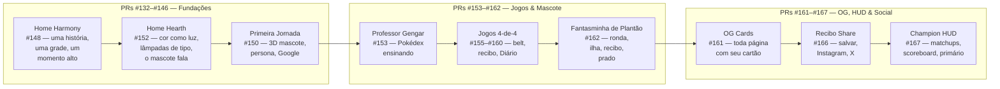
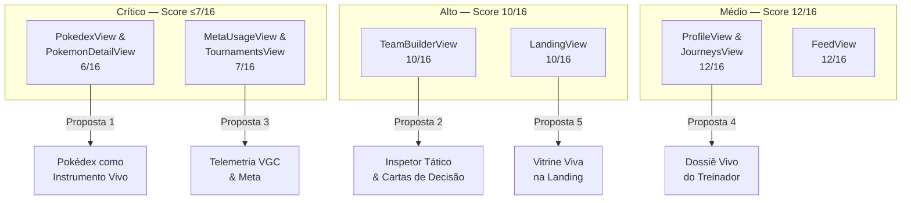

# Auditoria UI/UX Disruptiva — 2026-11-18

> **Escopo:** síntese das conquistas dos PRs #132–#167, auditoria quantitativa e
> qualitativa das superfícies remanescentes contra o **M3 0–1–2 Self-Audit**,
> as regras de **Taste-Frontend**, e as métricas de **Design System v3 drift**.

---

## 1. Síntese: o que os PRs #132–#167 já conquistaram

### 1.1 Conquistas por eixo

| Eixo criativo | O que foi feito | Dispositivos franquia usados |
|---|---|---|
| **Cenas Vivas** | Home reage ao dia (herói muda humor, 2/2 dourado), mascote como assistente e companheiro em jogos, quiz, fórum, meta | Silhueta ("não jogou"), dourado ("ganhou"), evolução (nível), tipo como tom |
| **Instrumento Pokédex** | Professor Gengar ensina a Pokédex, `ProfessorEntry.jsx`; barras de stat com cores canônicas; TypeChip substitui TypeBadge caps | Cor de tipo = informação, artwork oficial = protagonista |
| **Neon Sticker & Material v2** | Lip no botão primário; springs reais (glide/pop); anel focus triplo (ink/pink/gold); adesivo em slots preenchidos; mascote viaja entre segmentados/tabs | Calmo no meio, alto no pico; ouro só no mérito |
| **Jogos como motor** | 4 jogos/dia com belt, recibo, receipt share (imagem 1080×1350), ilha ao vivo, próximo jogo, pips no dock/rail | Poké Balls como dias, silhueta até jogar |
| **Social Heart** | Diário do dia, Pokégear inbox, prado de amigos, recibo no fórum, strip do Champion | Fantasmas de amigos nas cores deles |
| **Narrativa pessoal** | Primeira Jornada 3D, pixel banner de uid, Team Sheet na cor do líder, Trainer Card com "figure+muted word" | Uid como pixels (nenhum igual), cor do tipo do líder |
| **SEO & link previews** | Cada página com OG card próprio, sitemap, `PAGE_CARDS` obrigatório com teste | — |

### 1.2 O que ficou intocado (escopo desta auditoria)

As superfícies que **não** receberam o passe criativo do Home/Jogos/Mascote:

- `PokedexView` / `PokemonDetailView` / `PokemonDetailPanel`
- `TeamBuilderView` / `MobileTeamBuilderView`
- `MetaUsageView` / `PokemonUsageView` / `TournamentsView`
- `ProfileView` / `JourneysView`
- `LandingView`
- `FeedView`

---

## 2. Auditoria M3 0–1–2 Self-Audit — Superfícies Remanescentes

Critérios do M3 Self-Audit: `0` = incorreto/ausente, `1` = parcial, `2` = pronto.

### 2.1 PokedexView & PokemonDetailView / PokemonDetailPanel

| Categoria | Score | Evidência |
|---|:---:|---|
| **Clareza da tarefa** | 1 | A ação primária (adicionar ao time) se perde entre tabs; nenhum CTA "Usar no Construtor" visível no detail |
| **Hierarquia da informação** | 1 | Seções dentro de caixas bordejadas (`team-builder-panel`) aninhadas no painel de detail; o "USAGE STATS" da referência `pokemon_detail_idea.png` inexiste |
| **Semântica de componentes** | 1 | 25 cores hex crus no PokemonDetailPanel; TypeBadge caps ainda aparece ao lado de TypeChip |
| **Disciplina de tokens** | 0 | 25 hex crus + `pdv__*` morto (37 classes sem referência JSX); radius por utilities (`rounded-xl`) ≠ `--radius-lg` |
| **Comportamento adaptativo** | 1 | Duas views separadas (desktop/mobile) em vez de layout adaptativo; o painel desktop é uma coluna larga sem tirar proveito do espaço |
| **Estados & feedback** | 1 | Skeleton presente; erros e vazios usam `<EmptyState>`; faltam estados de comparação e ação rápida |
| **Acessibilidade** | 1 | Focus ring funciona; contraste do muted no eclipse (3.89:1) falha; stat bars com dígitos brancos sobre barras coloridas sem rótulo sr-only |
| **Contenção expressiva** | 0 | Bordas aninhadas: painel > seção > card de habilidade; "ATRIBUTOS BASE" em caps |
| **Pontuação** | **6/16** | Pior entre as superfícies — mais distante da direção criativa |

### 2.2 TeamBuilderView / MobileTeamBuilderView

| Categoria | Score | Evidência |
|---|:---:|---|
| **Clareza da tarefa** | 2 | A ação "adicionar membro" é clara; slot interativo; mascote verdict |
| **Hierarquia da informação** | 1 | 50+ anéis "Top Meta Pick" roxos competem com os Pokémon; a análise de tipo é um painel longo que rola |
| **Semântica de componentes** | 1 | `team-builder-button/field` como primitivas globais de fato; `team-builder-panel` é genérico |
| **Disciplina de tokens** | 1 | Radius OK em CSS; cores de borda hover com primário cru (`--color-border-hover` ×51) |
| **Comportamento adaptativo** | 1 | Duas views separadas (desktop ≠ mobile); não escala entre tablet e desktop largo |
| **Estados & feedback** | 2 | Coach, verdict, slot preenchido, análise, Showdown export |
| **Acessibilidade** | 1 | Alvos de toque 44px; foco OK; autocomplete `z-dropdown` corrigido; contraste muted borderline |
| **Contenção expressiva** | 1 | Painel envolve a página no desktop; seções bordejadas dentro do painel |
| **Pontuação** | **10/16** | Funcional, mas cromado demais e contido em excesso |

### 2.3 MetaUsageView / TournamentsView

| Categoria | Score | Evidência |
|---|:---:|---|
| **Clareza da tarefa** | 1 | Meta mostra dados mas nenhuma ação "Montar com este core" ou "Desafiar com este time" |
| **Hierarquia da informação** | 1 | Chip grid de torneios é uniforme — nenhum torneio recente em destaque; "FEATURED TEAMS" em caps com bordas idênticas |
| **Semântica de componentes** | 1 | Cards de torneio são todos iguais sem badge de posição (referência `tournaments_teams_idea.png` mostra badge de ranking) |
| **Disciplina de tokens** | 1 | `meta-view.css` é phone-only (desktop 100% utilities); 22 hex crus no Gyms; Tailwind palette classes |
| **Comportamento adaptativo** | 1 | Torneios: 4-col grid fixo; sem pane de detalhe, cada time abre uma página nova |
| **Estados & feedback** | 1 | Loading OK; nenhum empty state para "nenhum torneio nesta regulação" |
| **Acessibilidade** | 1 | Foco funciona; contraste OK em dark; os usage % são `text-muted` sobre surface |
| **Contenção expressiva** | 0 | Bordas aninhadas: grid de torneios > card de time > sprites. Cards idênticos sem hierarquia |
| **Pontuação** | **7/16** | Dados sem ação e sem hierarquia expressiva |

### 2.4 ProfileView / JourneysView

| Categoria | Score | Evidência |
|---|:---:|---|
| **Clareza da tarefa** | 2 | Profile é configuração clara; Journeys é progresso claro |
| **Hierarquia da informação** | 1 | Stats no Profile são mini-cards com bordas (proposto "figure+muted word" na creative_direction mas não aplicado); Journeys totals em caixas |
| **Semântica de componentes** | 2 | Switches, segmentados, listas de settings corretos |
| **Disciplina de tokens** | 1 | `profile-view.css` tem spacing OK mas radius utilities misturados |
| **Comportamento adaptativo** | 1 | Coluna única em todas as larguras; sem two-pane settings M3 no desktop |
| **Estados & feedback** | 2 | Badges, XP, streak, missões com status correto |
| **Acessibilidade** | 2 | Focus ring, contraste OK, alvos adequados |
| **Contenção expressiva** | 1 | Hero ainda mostra avatar em caixa; stats como mini-tiles em vez de figure+muted word |
| **Pontuação** | **12/16** | Perto, mas hierarquia de dados e adaptividade faltam |

### 2.5 LandingView

| Categoria | Score | Evidência |
|---|:---:|---|
| **Clareza da tarefa** | 2 | "Monte seu time" é o CTA primário; mascote xl vivo |
| **Hierarquia da informação** | 1 | "Jogue hoje" mostra apenas 3 jogos (backlog de games.md); as features abaixo do hero são cards uniformes |
| **Semântica de componentes** | 1 | CTA "Começar" OK; faltam cards de jogo com art de silhueta e status |
| **Disciplina de tokens** | 1 | `landing.css` usa tokens; Tailwind palette em alguns detalhes |
| **Comportamento adaptativo** | 1 | Hero layout phone OK (Enzo: "words left, scene right"); desktop alonga sem tirar proveito |
| **Estados & feedback** | 1 | Loading OK; nenhum "logged in" landing state; sem app-frame |
| **Acessibilidade** | 2 | Focus, contraste, alvos OK |
| **Contenção expressiva** | 1 | Features são cards bordejados uniformes; falta o momento "dealt" |
| **Pontuação** | **10/16** | Funciona como porta de entrada, mas sem vitrine viva |

### 2.6 FeedView (Diário / Centro Pokémon)

| Categoria | Score | Evidência |
|---|:---:|---|
| **Clareza da tarefa** | 2 | Postar e ler é claro |
| **Hierarquia da informação** | 1 | Thread list é linear sem destaque para tendências ou pins |
| **Semântica de componentes** | 2 | Composer, reactions, share cards corretos |
| **Disciplina de tokens** | 1 | `forum-view.css` 70 classes mortas; 14 hex crus |
| **Comportamento adaptativo** | 1 | Coluna única; nenhum pane de thread aberta ao lado no desktop |
| **Estados & feedback** | 2 | Loading, posting, reactions corretos |
| **Acessibilidade** | 2 | Focus ring, contraste, semântica |
| **Contenção expressiva** | 1 | Mensagens uniformes; mascot faces nos reactions são boas |
| **Pontuação** | **12/16** | Social funcional mas sem o "dealt moment" |

---

## 3. Taste-Frontend Audit

Critérios-chave do `design-taste-frontend` aplicados ao PokemonBuilder:

| Regra Taste-Frontend | Conformidade | Evidência |
|---|:---:|---|
| **Nenhuma legenda sob visual** | ✅ | Sem captions sob sprites/artwork |
| **Todo visual renderiza em 1440/390** | ⚠️ | O PokemonDetailPanel desktop exibe overflow horizontal na stat bench; MetaUsage OK |
| **Uma seção por tela** | ❌ | PokedexView mostra grid + filtros + resultados numa tela; MetaUsage empilha torneio + usage |
| **Bordas laterais iguais** | ⚠️ | Home OK após harmony; Builder e Detail têm padding assimétrico em certos breakpoints |
| **Hover micro-animations** | ✅ | Hover gated pelo build; cards levantam; buttons pressionam via `--press-scale` |
| **Sem tilt, carousels, timed tabs** | ✅ | Nenhum tilt/carousel |
| **Uma entrada no hero + 1-2 "dealt moments"** | ⚠️ | Home tem entrada + dealt moments; Landing, Pokédex, Builder, Meta não têm |
| **O app-frame mostra a UI real** | ❌ | Landing não usa app-frame para showcase |

**Resumo Taste-Frontend:** 3 conformes, 3 parciais, 2 falhas. As falhas estão concentradas em Pokédex/Builder/Meta (hierarquia de seção) e Landing (vitrine).

---

## 4. Design System v3 Drift Metrics

### 4.1 Typography sprawl

| Métrica | Valor atual | Meta v3 |
|---|---|---|
| Valores de `font-size` distintos | ~76 | 9 roles |
| `text-[Npx]` arbitrários em JSX | ~237 | 0 |
| Pesos `extrabold/black` | ~52 | 0 (cap em 600) |
| `uppercase` heading-level | ~30 CSS + 111 JSX | Apenas micro tags |
| Mono em prosa | Pokédex flavor text, descriptions | Nunca |

**Veredicto:** sprawl tipográfico é o maior débito restante — equivalente ao "58 valores de spacing" pré-v2.

### 4.2 Raw Tailwind colours

| Área | Instâncias | Arquivos mais afetados |
|---|---|---|
| Hex crus em CSS | ~133 | tools, guesser, home, battle, forum |
| Hex crus em JSX | ~147 | PokemonDetailPanel (25), GymsView (22) |
| Tailwind palette classes | ~161 | `text-slate-500`, `bg-red-500/20`, `text-amber-400` |

**Veredicto:** PokemonDetailPanel e GymsView são os piores ofensores.

### 4.3 Containment & nested borders

| Hotspot | Padrão | O que violar |
|---|---|---|
| `PokemonDetailPanel` | `team-builder-panel > section-box > ability-card` | Regra "nunca card-in-card" |
| `TeamBuilderView` desktop | `page panel > analysis panel > type section` | "Uma seção é heading+conteúdo, não caixa" |
| `TournamentsView` | `grid > tournament card > team card > sprite row` | 3 níveis de contenção |
| `ProfileView` | `hero box > stat mini-cards` | Proposto "figure+muted word" |

### 4.4 Mobile fold & thumb ergonomics

| Superfície | Fold (390×844) | Thumb zone |
|---|---|---|
| Home | ✅ Herói + pill ação sob headline, acima do dock | ✅ |
| Builder (mobile) | ⚠️ Painel de análise exige scroll longo | ⚠️ Slots OK; filtros de tier no topo |
| Pokédex | ⚠️ Grid sem priorização; filtro no topo | ❌ Tabs de geração fora do alcance do polegar |
| Detail (mobile) | ⚠️ Stats abaixo do fold; habilidades exigem scroll | ⚠️ |
| Meta | ✅ Chip filters acessíveis | ✅ |
| Profile | ✅ Avatar e ações no primeiro fold | ✅ |
| Landing | ✅ Hero + CTA visíveis | ✅ |

---

## 5. Mapa de prioridade para o plano v4

---

## 6. Fase 3 do Fantasminha de Plantão — o que falta construir

O artefato `Fantasminha de Plantão.html` (aprovado por Enzo com "EU AMEI! TA INCRIVEL") define
3 fases. **Fases 1 e 2 foram construídas** nos PRs #162, #164 e #166. **Fase 3 está aberta:**

| Peça | Descrição | Arquitetura proposta no artefato |
|---|---|---|
| **A Mímica no Diário** | Todo dia o mascote imita um Pokémon no Diário; 5 pistas (tom, tamanho, gesto, lugar, silhueta); acertar cedo = melhor quadradinho; mora no topo do Diário, não no cinto (o dia continua com 4 jogos) | `utils/dailyMime.js` com `MIME_ACTS` de Kanto primeiro; palpites nos comentários; respostas certas escondidas até acertar; compartilhar "Mímica nº X · na Yª pista" com 5 quadradinhos |
| **O Ovo (EggSurprise)** | 5 dias completos (4/4), quando forem, sem sequência e sem zerar. Cada dia completo racha o ovo; no 5º, choca um traje novo para o mascote | `<EggMeter>` no cinto de `/games`; traje em `cosmetics.js` + `publicProfiles` (teste cobra); `useRewardsStore`; patch notes com doação |

**Regras "Fica de pé"** do artefato: a Mímica mora no Diário (não é 5º jogo), o Pokémon fica
escondido até a última pista, comemora só o seu acerto. O Ovo: sem moeda (XP nunca gasto),
ouro só ao chocar, sem sequência (nada zera). Ambas seguem `drive-motivation`: zero "if-then"
reward, zero guilt.

---

## 7. Referências cruzadas — Matriz completa de 12 skills

| # | Skill / referência | Fonte | Insight absorvido para o plano v4 |
|---|---|---|---|
| 1 | **AffectUI** | `affectui.com` / `flohoeller/affectui` | Decision Cards → Cartas de Decisão do Mascote (P2); Context Map → Synergy Matrix (P2); Trace Waterfall → split win/usage (P3); Number Ticker → stat/EV tickers (P1, P4); Agent Trail → jornada (P4) |
| 2 | **Material Design 3 UI** | `skydashnet` | 0-1-2 Self-Audit como régua de qualidade; adaptive list-detail/supporting pane; semântica de tokens; contenção sem card-in-card |
| 3 | **Anti UI Slop / uizze** | `uizze.com` | Zero uniform cards; zero caps headings; zero number-labels fora de sequência; a hierarquia vem de tamanho + cor, não bold stacking |
| 4 | **Impeccable** | `impeccable.style` | Modes (Operate no Builder, Read na Meta, Experience no Pokédex); craft-floor quality gate; "finish the job" |
| 5 | **Taste Skill** | `Leonxlnx` | Uma seção por tela; bordas iguais; app-frame com UI real; dealt moments; hover micro-animations; anti-slop gate |
| 6 | **Emil Design Engineering** | `emilkowalski/skills` | Springs concêntricos; radii proporcionais; micro-interactions ≤600ms; "motion explains, never decorates" |
| 7 | **Vercel Web Design Guidelines** | Web Design Guidelines | Focus ring, contraste AA, keyboard-first, responsive without layout shift |
| 8 | **Frontend Design (Anthropic)** | Anthropic | Sujeito real lidera; tipografia carrega personalidade; zero word-accent; zero numbered markers fora de sequência |
| 9 | **Hallmark** | `Nutlope/hallmark` | Copy voice: plain copy in its own voice; zero "AI-sounding" superlatives; product truth |
| 10 | **Make Interfaces Feel Better** | `jakubkrehel` | Tactile feedback on every control; press-to-confirm; undo > confirm dialog |
| 11 | **UI UX Pro Max** | `nextlevelbuilder` | Checklist de acessibilidade e toque (já instalada); GSAP presets; palette audit |
| 12 | **Stageshow** | `benjitaylor/skills` | Entrance choreography; one "loud moment" per page; dealt → staggered → idle |
| — | **Fantasminha de Plantão.html** | Artefato do projeto | Metodologia de proposta disruptiva: "De onde vem · O que faz bem → Vira aqui", "Fica de pé", primitivas guardadas, PBMascot como motor de prototipagem viva |
| — | **Creative Direction** | `docs/modules/creative_direction.md` | Cena responde; falar com dispositivos franquia; ouro só no mérito; motion dentro do elemento |
| — | **Design System v3** | `docs/plans/design-system-v3.md` | 9 roles de tipo, contraste AA, `--color-fg-secondary`, neutral-inverted primary |
| — | **Drive Motivation** | `wondelai/skills` | AMP: XP como maestria (nunca moeda); badges como propósito visual; autonomia nas 4T; penalidade −2 para "if-then" rewards |
| — | **`new-ideas/*.png`** | Referências visuais | `pokemon_detail_idea.png` = stat bench + EV bench + usage inline; `tournaments_teams_idea.png` = badge de ranking + strip de 6; `Home_with_ideas.png` = torneios em carousel |
