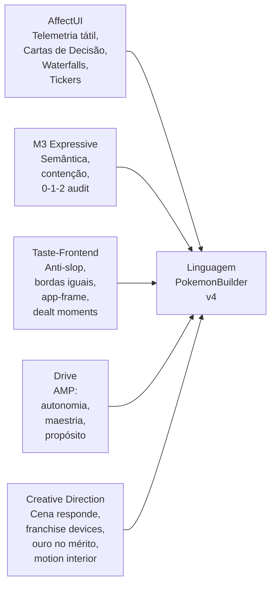
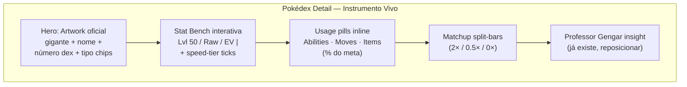
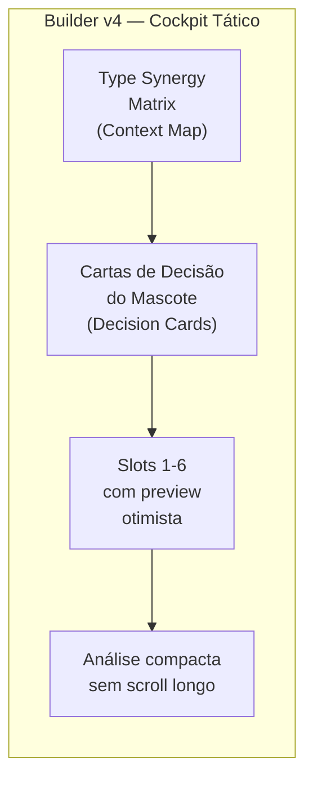
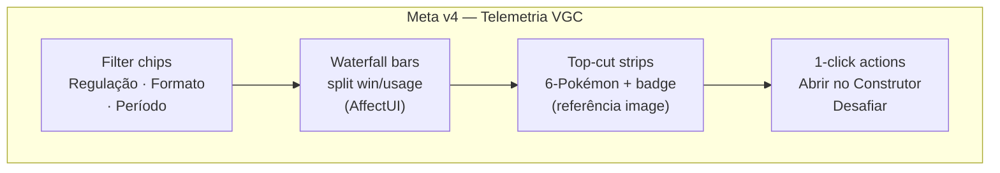
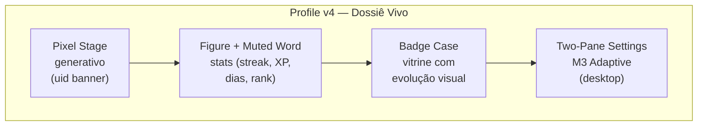
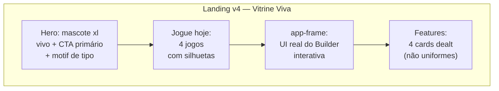
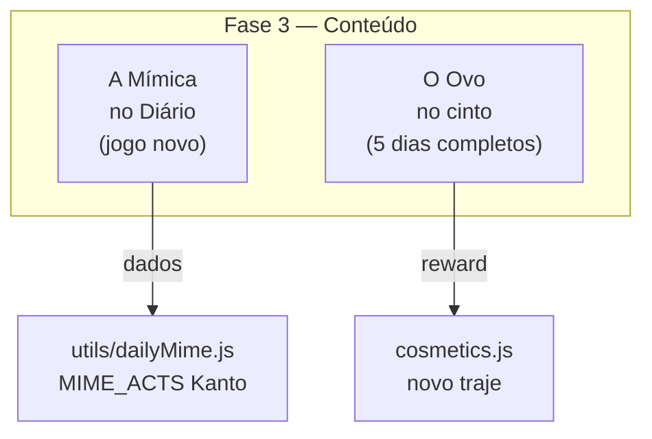
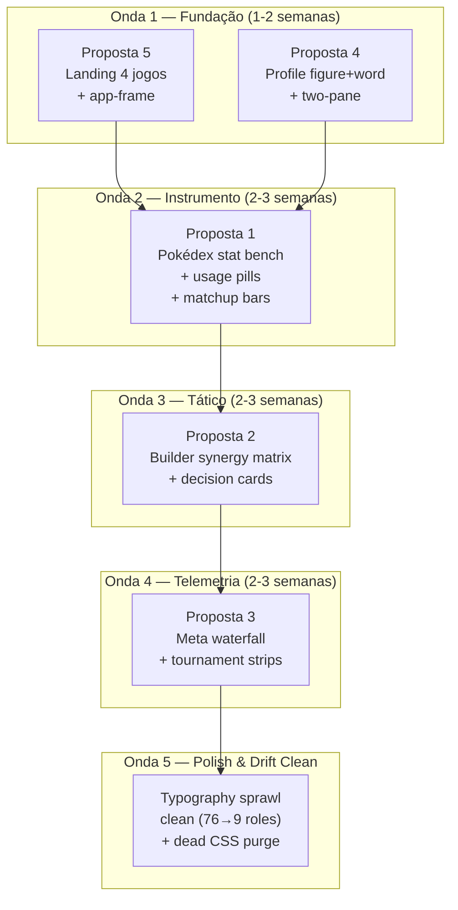

# O Próximo Salto: Instrumento Tático & Cenas Vivas v4

> **Proposta criativa mestra** — traduzindo **AffectUI + Material Design 3
> Expressive + Taste-Frontend** em 5 ondas de produto concretas, sem violar
> o Neon Sticker nem o `--space-*` grid.
>
> Cada proposta inclui: especificações de componente, roles de token,
> micro-interações (≤600ms, dentro do elemento) e roadmap de implementação.

---

## Princípios transversais (as 5 lentes)



| Lente | Regra traduzida para PokemonBuilder |
|---|---|
| **AffectUI** | Componentes de telemetria (waterfalls, tickers, decision cards) são *traduzidos* na estética Neon Sticker — cores de tipo como barras, não as barras cinzas de um SaaS. Um treemap vira "mapa de sinergia". |
| **M3 Expressive** | Uma ou duas *levers expressivas* por superfície (tamanho + cor no Pokédex stat hero; forma + contenção nas cartas de decisão do Builder); o restante fica calmo. Sem card-in-card, sem FAB, sem chips como botões. |
| **Taste-Frontend** | Uma seção por tela (fold); bordas laterais iguais; `app-frame` com UI real na Landing; uma entrada de hero + 1-2 "dealt moments" por superfície. |
| **Drive (AMP)** | XP é maestria visual (progress bar, não moeda); badges são propósito (caso de conquista); autonomia = escolha de regulação, formato, persona. Zero reward-based guilt. Penalidade −2 para "if-then" rewards. |
| **Creative Direction** | Cena responde (stat bars reagem a EV slider); franchise devices (silhueta = não escolhido, evolução = progresso, ouro = mérito); motion dentro do elemento ≤600ms. |
| **Anti UI Slop** | Zero uniform cards; zero caps headings; zero number-labels fora de sequência; hierarquia por tamanho+cor, não bold stacking. |
| **Emil / Jakub** | Springs concêntricos; radii proporcionais; micro-interactions ≤600ms; tactile feedback em todo controle; undo > confirm dialog. |
| **Stageshow** | Entrance choreography: um "loud moment" por tela; dealt → staggered → idle. |
| **Hallmark** | Copy voice: plain copy in its own voice; zero "AI-sounding" superlatives. |
| **Fantasminha de Plantão** | Metodologia de proposta disruptiva: "De onde vem → O que faz bem → Vira aqui", "Fica de pé" (regras guardadas), primitivas do sistema (`<PixelScene>`, `<Receipt>`, `<Stamp>`, `<LiveIsland>`, `<PixelReveal>`, `<EggMeter>`), PBMascot 3D como motor de prototipagem. |

### Tokens que não mudam

Nenhuma proposta adiciona, remove ou renomeia tokens de spacing, cor primária, borda ou motion
existentes. Novas tokens semânticas vivem em **roles** (`--stat-*`, `--usage-*`) que resolvem para
os tokens v2/v3 existentes.

---

## Proposta 1 — Pokédex como Instrumento Vivo

### Escopo
`PokemonDetailView.jsx`, `PokemonDetailPanel.jsx`, `MobilePokemonDetailView.jsx`,
`pokemon-detail-view.css`, `pokemon-detail-mobile.css`, `SmogonCompetitivePanel.jsx`

### Visão
O Pokémon Detail deixa de ser uma ficha com caixas aninhadas e vira um **instrumento tátil** —
o treinador *opera* os dados, não apenas lê. Referências visuais: `pokemon_detail_idea.png` (stat
bench interativa + usage inline) + AffectUI Number Ticker + M3 List-Detail.



### Especificação de componentes

#### 1.1 Hero — Artwork Protagonista
- **Layout:** artwork oficial em tamanho hero (280px desktop, 200px phone) à esquerda, nome em
  `--text-2xl` mono 600, `#dex` em `--text-micro` muted, TypeChips sob o nome.
- **Fundo:** gradiente sutil do tipo primário a 8% opacity sobre `--color-bg` (nunca solid).
- **Zero caixa ao redor.** O hero é o canvas. Desktop: list-detail (lista de stats à direita,
  artwork à esquerda). Phone: artwork no topo, stats rolam abaixo.
- **Token map:** `--stat-hero-tint: color-mix(in oklch, var(--type-color) 8%, var(--color-bg))`

#### 1.2 Stat Bench Interativa
- **Layout:** 6 barras (HP, ATK, DEF, SP.ATK, SP.DEF, SPD) com cores canônicas (já existem).
- **Cada barra:** label mono `--text-sm` | barra fina (4px) com fill animado ≤400ms `--ease-glide` |
  valor `Raw / Lvl 50` em `--text-sm` mono tabular.
- **EV sliders:** sob cada barra, um slider discreto (0–252) em passos de 4. O valor total (510)
  aparece como ticker animado (AffectUI Number Ticker traduzido: dígitos rolam com `--ease-pop`).
- **Speed-tier benchmark ticks:** marcas na barra de SPD para thresholds conhecidos (base 100 = Jolly
  Garchomp, base 110 = Timid Latios, etc.) como linhas finas `--color-muted`.
- **Zero nested boxes.** Cada stat é uma linha na mesma superfície; o bloco inteiro é uma `section` com
  `section-head` "Atributos" e nada mais.
- **Micro-interação:** mover o EV slider faz a barra redimensionar em tempo real com `--ease-glide`
  (≤400ms). O ticker rola os dígitos. O mascote Professor olha para a stat mais alta e muda para
  `impressionado` quando uma stat ultrapassa 150 Lvl50.

#### 1.3 Usage % Pills Inline
- **Em Abilities:** cada ability row ganha um pill `--text-2xs` mono com `%` do meta
  (ex: "Lightning Rod 89.7%") alinhado à direita, fill `--color-primary-soft`.
- **Em Moves:** idem, com type icon à esquerda + `%`.
- **Em Items:** idem, com sprite do item 20px + `%`.
- **Dados:** `publicdata/usage-stats.json` (já carregado por `staticData.js`).
- **Sem caixa nova.** O pill é inline, parte da row. Sem borda de seção.

#### 1.4 Matchup Split-Bars
- **Layout:** um grid 2-col de split-bars (inspiração: AffectUI Waterfall + community boards
  "split progress bar").
- **Cada barra:** tipo atacante à esquerda, barra bicolor (verde 2× | vermelho 0.5×) com
  largura proporcional, label `2×` ou `0.5×` em `--text-2xs` mono.
- **Zero tabs para matchups.** Um scroll horizontal compacto.

#### 1.5 Professor Gengar Insight (reposicionar)
- Já existe em `ProfessorEntry.jsx`. Move para dentro do hero do detail como um `aside` com
  speech bubble, à direita da artwork no desktop, abaixo no phone.
- Mood: `ensinando` (default), `impressionado` quando BST > 550.

### Tokens de role novos

```css
/* pokemon-detail — resolved from existing tokens */
--stat-hp: #59C785;     /* canon */
--stat-atk: #E87040;    /* canon */
--stat-def: #F0C048;    /* canon */
--stat-spa: #6890F0;    /* canon */
--stat-spd: #78C850;    /* canon */
--stat-spe: #F06098;    /* canon */
--stat-bar-h: 4px;
--stat-bar-radius: var(--radius-sm);
--usage-pill-bg: var(--color-primary-soft);
--matchup-positive: var(--color-success);
--matchup-negative: var(--color-danger);
```

### M3 Self-Audit Target: 14/16

| Categoria | Target | Como |
|---|:---:|---|
| Clareza da tarefa | 2 | CTA "Usar no Construtor" no hero |
| Hierarquia | 2 | Hero > Stats > Usage > Matchups, sem caixas |
| Semântica | 2 | Sliders nativos; TypeChip everywhere |
| Tokens | 2 | Zero hex cru; roles acima |
| Adaptativo | 2 | List-detail M3: lista à esquerda, detail à direita (desktop ≥1024); single pane (phone) |
| Estados | 1 | Loading, error, compare mode (futuro) |
| Acessibilidade | 2 | sr-only labels em sliders; contraste AA; focus ring |
| Contenção | 2 | Zero nested borders |

---

## Proposta 2 — Inspetor Tático & Cartas de Decisão no Builder

### Escopo
`TeamBuilderView.jsx`, `MobileTeamBuilderView.jsx`, `team-builder-view.css`

### Visão
O Builder deixa de ser "grid de Pokémon + painel de análise longo" e vira um **cockpit tático**:
o treinador vê sinergias e furos em tempo real, e o mascote sugere correções como **Cartas de
Decisão** (AffectUI Decision Cards traduzidas na estética Neon Sticker).



### 2.1 Type Synergy & Hazard Matrix (AffectUI Context Map → PokemonBuilder)

- **Conceito:** AffectUI's Context Map é um treemap de tokens/contexto. Aqui, vira um
  **treemap de sinergia de tipos**: cada tipo do time é uma célula cujo tamanho é proporcional
  à cobertura defensiva, e cuja cor é a cor canônica do tipo.
- **Layout:** grid 6×3 compacto (tipos atacantes × resistentes), células preenchidas com
  `color-mix(in oklch, var(--type-color) 25%, var(--color-surface))`.
- **Interação:** hover numa célula destaca quais membros do time cobrem/são fracos a esse tipo.
- **Sem borda de painel.** O matrix é uma seção direta da view.
- **Phone:** colapsa num strip horizontal scrollável de badges de tipo com contagem.

### 2.2 Cartas de Decisão do Mascote (AffectUI Decision Cards → PokemonBuilder)

- **Conceito:** quando o time tem um furo (ex: 3 membros fracos a Ground), o mascote oferece
  uma **Carta de Decisão**: "Seu time tem 3 fraquezas Ground. Sugestão: Rotom-Wash cobre
  Ground, Water e Electric."
- **Layout:** card com face do mascote (`MascotFace` mood `preocupado`), texto, e dois botões:
  "Adicionar" (otimista preview: o slot 4 mostra o Pokémon sugerido com 50% opacity ≤400ms,
  `--ease-glide`) e "Ignorar" (fold do card com `--ease-pop`).
- **Undo:** se adicionado, toast com undo (já existe `useShinyBurst` pattern).
- **Máximo 2 cartas simultâneas.** Uma por furo crítico. Sem spam.
- **Tokens:** `--decision-card-bg: var(--color-surface-raised)`, sem borda (fill only),
  `--radius-lg`, `--elevation-2`.
- **Micro-interação:** a carta entra por baixo com `--ease-bounce` (≤350ms), sai com fade
  `--duration-fast`. O mascote muda para `animado` se aceita, `curioso` se ignora.

### 2.3 Análise Compacta

- **Remover** o painel de análise longo que rola. Substituir por:
  - **Cobertura:** a matrix de sinergia (2.1) já mostra.
  - **Verdict do mascote:** já existe (`MascotVerdict`), fica como headline da seção de análise.
  - **Weakness summary:** 3 linhas máximo, cada fraqueza com split-bar de severidade.
  - **Showdown export:** botão ghost no footer da análise.

### 2.4 Supporting Pane (M3 Adaptive)

- **Desktop ≥1200px:** o time (slots + analysis) é o pane principal à esquerda; o grid de
  Pokémon é o pane de suporte à direita. Inversão do layout atual.
- **Tablet 768–1199px:** pane único com grid colapsável.
- **Phone <768:** idem atual (mobile builder), com matrix como strip e cartas de decisão
  como bottom sheet.

### Tokens de role novos

```css
--synergy-cover: color-mix(in oklch, var(--type-color) 25%, var(--color-surface));
--synergy-weak: color-mix(in oklch, var(--color-danger) 20%, var(--color-surface));
--decision-card-bg: var(--color-surface-raised);
--decision-card-radius: var(--radius-lg);
```

### M3 Self-Audit Target: 15/16

---

## Proposta 3 — Telemetria de Meta & Torneios

### Escopo
`MetaUsageView.jsx`, `PokemonUsageView.jsx`, `TournamentsView.jsx`, `meta-view.css`

### Visão
O Meta deixa de ser uma tabela de dados passiva e vira uma **central de inteligência competitiva**:
barras split de win/usage (AffectUI Waterfall), tournament top-cut strips com 6 Pokémon (referência
`tournaments_teams_idea.png`), e 1-click "Abrir no Construtor" / "Desafiar com este time".



### 3.1 Waterfall Usage/Win Bars (AffectUI Trace Waterfall → PokemonBuilder)

- **Conceito:** cada Pokémon no meta tem duas barras sobrepostas: usage % (azul, fill sólido)
  e win rate % (verde ou vermelho, contorno sobre a mesma barra).
- **Layout:** lista vertical, cada row: sprite 32px | nome `--text-sm` | barra split 200px |
  `%` em `--text-2xs` mono tabular.
- **Interação:** tap na barra abre um tooltip compacto com evolution do usage nas últimas 4 semanas
  (mini-sparkline em canvas, 60×20px, 4 pontos, `--color-primary`).
- **Sem caixa por Pokémon.** Cada row é um item de lista, divido por `--color-border` hairline.

### 3.2 Tournament Top-Cut Strips

Baseado em `tournaments_teams_idea.png`:

- **Cada top-cut:** badge de posição (#1 gold, #2 silver, #3 bronze, #4+ `--color-muted`) |
  record (W-L) em `--text-sm` mono | strip de 6 sprites (40px cada) | "Abrir" link.
- **Badge:** `--brand-gold` para #1, `--color-fg` para #2-3, `--color-muted` para #4+.
  Nunca um circle badge — um número bold seguido de W-L.
- **1-click "Abrir no Construtor":** navega para `/builder` com o time pré-carregado (já existe
  `loadTeamIntoBuilder` pattern).
- **1-click "Desafiar com este time":** navega para `/challenge?team=` com os 6 ids.
- **Layout:** cards em 4-col grid desktop, 1-col phone. Cada card: `--radius-md`, `--color-surface`,
  sem nested borders.

### 3.3 Filter Chips Semânticos

- **Regulação:** `Reg M-B`, `Reg M-A`, `Reg L` etc. Chips filtrantes `--text-label`.
- **Período:** "Esta semana", "Este mês", "Top Cut".
- **Formato:** VGC, BSS, OU etc.
- **Chip ativo:** fill `--color-primary-soft` com borda `--color-primary`. Chip inativo: `--color-surface-raised`.

### Tokens de role novos

```css
--usage-bar-fill: var(--color-primary);
--usage-bar-win: var(--color-success);
--usage-bar-loss: var(--color-danger);
--ranking-gold: var(--brand-gold);
--ranking-silver: #94A3B8;
--ranking-bronze: #D97706;
```

### M3 Self-Audit Target: 14/16

---

## Proposta 4 — Dossiê Vivo do Treinador

### Escopo
`ProfileView.jsx`, `JourneysView.jsx`, `profile-view.css`, `journeys.css`

### Visão
O Profile deixa de ser "settings com avatar" e vira um **dossiê tático vivo**: o treinador é
o protagonista de sua própria narrativa, com stats que respiram ("figure+muted word"),
um pixel stage generativo, e uma vitrine de badges.



### 4.1 Pixel Stage Generativo (já existe como conceito no Trainer Card)

- **Expandir** o pixel banner do uid (`trainerCardPattern.js`) para o hero do Profile.
- **Layout:** banner 100% width, 120px height, com pixels do uid na cor do tipo da persona.
- **O artwork do parceiro** (a greeting Pokémon) fica sobre o banner, em tamanho hero (200px),
  cortado pela borda inferior do banner.
- **Zero caixa ao redor.** Banner → artwork → stats, tudo na superfície.

### 4.2 Figure + Muted Word (Creative Direction backlog)

- **Substituir** os mini-cards de stat por texto "figure+muted word":
  - `142` **dias** (muted) · `17` **sequência** (muted) · `2.450` **XP** (muted) · `#38` **ranking** (muted)
- **Figure:** `--text-xl` mono 600, `--color-fg`. **Word:** `--text-caption` sans 400, `--color-muted`.
- **Inline, sem caixa.** Os pares ficam numa linha horizontal com `--space-8` gap.
- **Micro-interação:** AffectUI Number Ticker nos figures — dígitos rolam com `--ease-pop` (≤500ms)
  quando o Profile monta pela primeira vez na sessão.

### 4.3 Badge Case Vitrine (expandir o existente)

- Já existe `BadgeCase.jsx`. Expandir para o Profile como seção "Conquistas":
  - Badges ganhos: cor do tipo do jogo, com glow sutil (`--sticker` filter).
  - Badges não ganhos: silhueta (escala de cinza, opacity 40%).
  - **Evolution-line XP:** sob os badges, uma barra de evolução (ex: Gastly → Haunter → Gengar)
    mostrando o progresso de XP até o próximo nível, com a silhueta do próximo estágio.
- **Interação:** tap num badge mostra um tooltip com data de conquista e descrição.

### 4.4 Two-Pane Settings (M3 Adaptive)

- **Desktop ≥1024px:** Profile vira list-detail. Lista de seções à esquerda (Conta, Aparência,
  Mascote, Privacidade, Sobre). Detail pane à direita com o conteúdo da seção selecionada.
- **Phone:** idem atual (single pane com seções colapsáveis).
- **Token:** nenhum novo. Usa o list-detail pattern existente do M3 Adaptive reference.

### M3 Self-Audit Target: 15/16

---

## Proposta 5 — Vitrine Viva na Landing

### Escopo
`LandingView.jsx`, `landing.css`, `playToday.js`, `prerenderHome.mjs`

### Visão
A Landing deixa de ser "hero + features" e vira uma **vitrine interativa** do produto:
4 jogos do dia com art e status, e um `app-frame` Taste-Frontend mostrando a UI real do
Builder em ação.



### 5.1 "Jogue hoje" — 4 Jogos Completos

- **Backlog de `games.md`:** "The landing's 'Jogue hoje' still shows three games."
- **Layout:** 4 cards em grid `2×2` phone / `4×1` desktop, cada um com:
  - **Silhueta do jogo** (franchise device: Pokémon silhueta para Champion, peça para PokéPuzzle,
    "?" para Quiz, tier para Tier List) até jogar → artwork quando jogado.
  - **Nome:** `--text-label` sans 500.
  - **Badge de navHue:** a cor canônica do jogo (`utils/navHue.js`) como dot no canto.
  - **Status:** "Aberto hoje" / "Feito hoje" como texto `--text-caption`.
  - **Link:** `/challenge`, `/pokepuzzle`, `/quiz?tab=categories&daily=1`, `/tier-list?daily=1`.
- **Token:** `--game-card-tint: color-mix(in oklch, var(--nav-hue) 10%, var(--color-surface))`.

### 5.2 App-Frame Showcase (Taste-Frontend)

- **Conceito:** Taste-Frontend rule "o app-frame mostra a UI real". Na Landing, um frame
  estilo browser/app que mostra o Builder com um time de exemplo (os 6 do top-cut do último
  torneio), com slots preenchidos, TypeChips, e a matrix de sinergia funcionando.
- **Layout:** `app-frame` com `--radius-xl` border, `--color-surface` fill, shadow `--elevation-3`.
  Dentro: screenshot real do Builder (pre-renderizado como imagem estática 1200×700) com
  overlay interativo de hover nos slots.
- **Phone:** a imagem escala com `object-fit: contain`; o frame ocupa 90vw.
- **Dealt moment:** ao scrollar para o app-frame, ele entra com `--ease-glide` (≤500ms)
  e os slots "preenchem" um a um com delay stagger de 100ms.

### 5.3 Features como Dealt Moments

- **4 features** em vez de cards uniformes, alternando layout:
  1. **Texto esquerda, visual direita** (o Builder com 6 slots preenchidos).
  2. **Visual esquerda, texto direita** (a Pokédex com stat bench).
  3. **Full-width visual** (o meta waterfall com 10 Pokémon).
  4. **Texto centro, mascote** (o Fantasminha de Plantão com seu recibo).
- **Uma seção por tela** (Taste-Frontend rule).
- **Dealt moment:** seção 2 entra com a stat bench animando suas barras da esquerda.

### M3 Self-Audit Target: 14/16

---

## Proposta 6 — Fase 3 do Fantasminha de Plantão: Mímica & Ovo Surpresa

> **Continuação direta do artefato aprovado por Enzo** ("EU AMEI! TA INCRIVEL").
> Fases 1-2 construídas nos PRs #162, #164, #166. Fase 3 é a peça que falta.

### Escopo
`utils/dailyMime.js` (novo), `utils/mimeActs.js` (novo), `components/forum/DailyMime.jsx` (novo),
`components/mascot/EggSurprise.jsx` (novo), `constants/cosmetics.js`, `views/GamesView.jsx`,
`styles/games-hub.css`, `styles/forum-view.css`



### 6.1 A Mímica no Diário

**De onde vem:** o mime.js do artefato (o mascote já faz mímica no quiz individual — `utils/mascot/mime.js`).
**O que faz bem → Vira aqui:** a mímica escala para o coletivo — todo o Centro adivinha.

#### Mecânica
- **Cada dia:** o mascote imita um Pokémon no topo do **Diário do dia** (forum).
- **5 pistas**, reveladas uma por uma ao tocar "Próxima pista":
  1. **Tom** — a cor do primeiro tipo (o mascote muda `--m-line` para a cor do tipo).
  2. **Tamanho** — ao lado de um treinador de 1,6m (sprite de escala do artefato).
  3. **Gesto** — `MIME_ACTS[pokemonId]` (postura + prop do rig, começando pelos 151 de Kanto).
  4. **Lugar** — região + habitat (`pokemon-index.json` generation + detail).
  5. **Silhueta** — artwork oficial em silhueta (filtro `brightness(0)` + `opacity(0.6)`).
- **Palpites:** nos comentários do Diário, com respostas certas escondidas (o mecanismo da
  silhueta de domingo — `spoiler` class no forum).
- **Acertou cedo:** melhor quadradinho (5 quadrados: 🟣🟣🟣⬜⬜ = acertou na 3ª pista).
- **Compartilhar:** "Mímica nº 37 · na 2ª pista 🟣🟣⬜⬜⬜" com `useDiaryShare`.

#### Implementação
- `utils/dailyMime.js` (puro, testável): `dailyMimeFor(dayNumber)` → `{ pokemonId, acts, clues }`,
  rotação coprime sobre Kanto (151 dias antes de repetir).
- `utils/mimeActs.js`: `MIME_ACTS` — tabela `pokemonId → { pose, prop?, tone }` para 151 de Kanto.
  Cada entrada usa moods/poses existentes do `catalog.js`.
- `components/forum/DailyMime.jsx`: no topo do Diário do dia, antes dos posts. Stage com
  `<PixelScene scene="route">`, o mascote vivo com gesto, pistas como `<ol class="clues">`,
  palpites em `<div class="guesses">`.
- **"Fica de pé"** (do artefato): a Mímica mora no Diário, o dia continua com 4 jogos;
  comemora só o seu acerto; a silhueta só aparece na última pista.

#### Tokens
Nenhum novo. Usa `--m-line` com cor de tipo, `--ease-pop` para hop no acerto,
`MascotFace`/`MascotCompanion` existentes.

### 6.2 O Ovo Surpresa (EggSurprise)

**De onde vem:** Egg OTP do Pin UI + dispositivo franquia (ovos chocam com passos).
**O que faz bem → Vira aqui:** os passos são dias de 4/4.

#### Mecânica
- **Localização:** no cinto de `/games` (já existe o belt de 4 Poké Balls).
- **5 dias completos** (4 jogos no dia), quando forem. **Sem sequência, sem zerar** (drive-motivation:
  zero guilt, zero "if-then").
- **A cada dia completo:** o ovo racha (`<EggMeter>` ganha uma marca + shake ≤400ms `--ease-pop`).
- **No 5º dia completo:** o ovo choca, revelando o mascote com um traje novo (animação ≤600ms:
  casca abre, raios dourados `--brand-gold`, mascote com traje aparece com `--ease-pop`).
- **O prêmio é dele:** um traje registrado em `cosmetics.js` (`useRewardsStore`), adicionado à
  lista de `publicProfiles` (teste cobra).

#### Implementação
- `components/mascot/EggSurprise.jsx`: SVG do ovo (do artefato: `viewBox="0 0 132 168"`,
  casca com manchas `--t-poison`, rachaduras progressivas `egg__crack[data-k]`).
- `utils/eggProgress.js` (puro, testável): `eggState(fullDays)` → `{ cracks: 0-5, hatched: bool }`.
  Lê de `roundReceipt.js` `withFullDay` (já conta dias completos, sem sequência).
- Trajes novos: 2-3 iniciais em `cosmetics.js` (chapéu de bruxa, boné de explorador, etc.).
- **"Fica de pé"** (do artefato): sem moeda; XP nunca gasto; traje é desbloqueio; ouro só ao chocar;
  notas da versão com pedido de doação.

#### Tokens
Nenhum novo. Usa `--brand-gold` para o momento de choca, `--ease-pop` para o shake/reveal.

#### Drive Motivation Audit
- **Autonomia:** o treinador joga quando quer, nenhum dia zera.
- **Maestria:** 5 dias de 4/4 é uma conquista tangível.
- **Propósito:** o traje é do mascote (do treinador), visível na campina.
- **Penalidade if-then:** zero — o ovo não ameaça, não zera, não mostra "X dias perdidos".

### M3 Self-Audit Target (Fase 3): 15/16

---

## Roadmap de Implementação



### Priorização

| Onda | Proposta | Impacto | Risco | Dependências |
|---|---|---|---|---|
| 1 | 5 (Landing) + 4 (Profile) | Alto — primeira impressão + engajamento | Baixo — views isoladas | `playToday.js` já existe; `prerenderHome.mjs` precisa update |
| 2 | 1 (Pokédex) | Muito alto — superfície mais visitada | Médio — `PokemonDetailPanel` é 25 hex crus | `staticData.js` para usage; `trainerCardPattern.js` para pixel stage |
| 3 | 2 (Builder) | Alto — core do produto | Alto — synergy matrix é componente novo | `teamAnalysis.js` para dados de sinergia |
| 4 | 3 (Meta) | Médio — público competitivo | Médio — torneios dependem de dados externos | `staticData.js` para torneios; layout novo |
| 5 | Drift clean | Alto — dívida acumulada | Baixo — sweep mecânico | Todas as props acima devem estabilizar primeiro |

### Arquivos tocados por proposta

| Proposta | Arquivos principais | CSS |
|---|---|---|
| 1 | `PokemonDetailView.jsx`, `PokemonDetailPanel.jsx`, `MobilePokemonDetailView.jsx`, `SmogonCompetitivePanel.jsx` | `pokemon-detail-view.css`, `pokemon-detail-mobile.css` |
| 2 | `TeamBuilderView.jsx`, `MobileTeamBuilderView.jsx` | `team-builder-view.css` |
| 3 | `MetaUsageView.jsx`, `PokemonUsageView.jsx`, `TournamentsView.jsx`, `TournamentTeamCard.jsx` | `meta-view.css` (novo: `tournament-strip.css`) |
| 4 | `ProfileView.jsx`, `JourneysView.jsx` | `profile-view.css`, `journeys.css` |
| 5 | `LandingView.jsx`, `playToday.js`, `playToday.test.js`, `prerenderHome.mjs` | `landing.css` |

### Métricas de sucesso

| Métrica | Baseline atual | Target v4 |
|---|---|---|
| M3 Self-Audit média (6 views) | 9.5/16 | 14.3/16 |
| Hex crus em CSS | ~133 | <20 (tools/battle legacy) |
| Hex crus em JSX | ~147 | <30 (type colours via tokens) |
| `text-[Npx]` arbitrários | ~237 | <10 |
| Nested borders (hotspots) | 4 views | 0 |
| Typography roles distintos | ~76 | 9 |
| Taste-Frontend compliance | 3/8 | 7/8 |
| Landing "Jogue hoje" jogos | 3 | 4 |

---

## Glossário de componentes AffectUI traduzidos

| AffectUI original | Tradução PokemonBuilder | Onde vive |
|---|---|---|
| Decision Cards | **Cartas de Decisão do Mascote** — fix suggestions com preview otimista | Builder (Proposta 2) |
| Context Map (treemap) | **Mapa de Sinergia de Tipos** — cobertura defensiva como treemap | Builder (Proposta 2) |
| Trace Waterfall | **Waterfall Usage/Win** — barras split de usage vs win rate | Meta (Proposta 3) |
| Agent Trail | **Trilha de Jornada** — badges com status (feito/atual/travado) | Journeys (Proposta 4) |
| Number Ticker | **Ticker Tático** — dígitos rolantes em stats, XP, EVs | Pokédex (Proposta 1), Profile (Proposta 4) |
